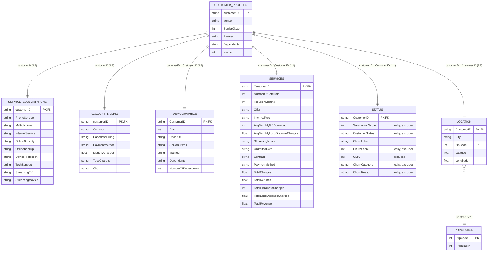

# Entity-relationship diagram (Phase 2)

Phase 1 had the three source 1 tables. Phase 2 adds the five source 2 tables.
Every customer table is one-to-one on the customer ID. Location to population
is many-to-one on zip code (1,626 zip codes used by 7,043 customers, out of
1,671 zip codes in the population file).

Source 2 tables list only the main columns. The full column-by-column mapping
is in `reports/tables/schema_mapping.csv`.
